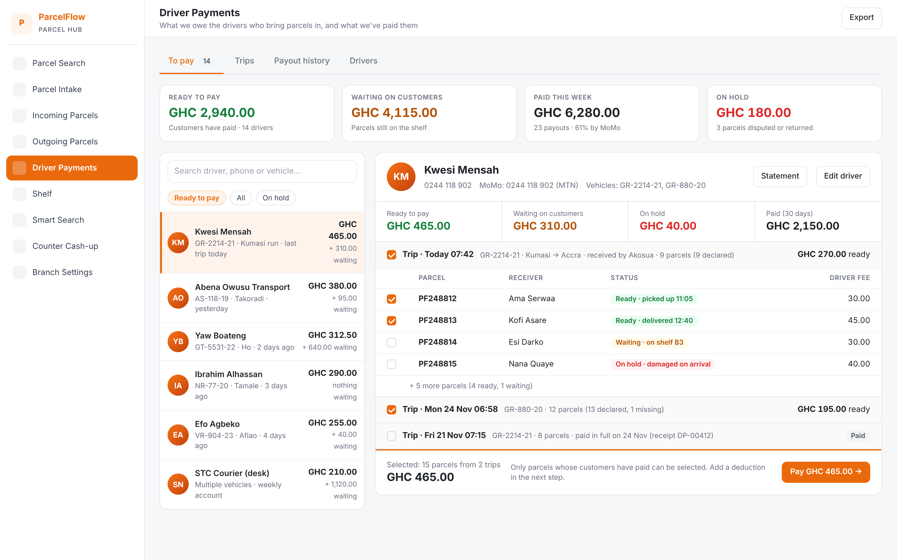
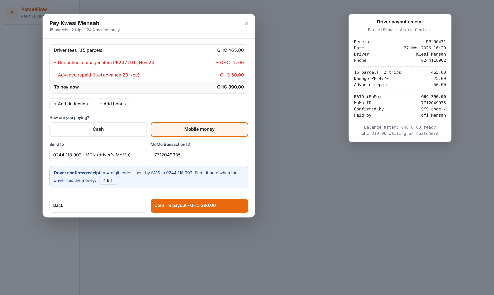
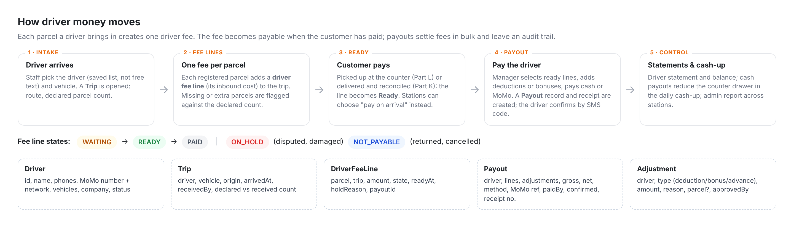

# Backend: what to work on now

This is the short list for the backend, as of 27 Nov 2026. It was checked against `https://backend-test.mandmservicescorp.org/shortly/v3/api-docs`. Everything else from the full handoff doc (`docs/BACKEND_HANDOFF.md`) is already in place on `backend-test`: delivery pins, rider locations and delivery check, route plans, the pickup charge, reconciliation lines, and station or location delete.

"Part J/K/L" references point to the full handoff doc; section 2 here is its Part L.

Work in this order:
1. **Fix three things on `backend-test`**, which the frontend relies on.
2. **Counter pickup payments and cash-up.** The frontend is built and waiting.
3. **Driver payments, the new design.** The frontend will be rebuilt on these endpoints.
4. **Release `backend-test` to production** (`backend-new`).
5. **Next features:** notifications, settings, fuel, motorbikes. These are planned; the frontend will follow.

---

## 1. Fix on backend-test (do first)

| What | Problem | Needed |
|---|---|---|
| **Parcel search** | The `search` query parameter was removed from `GET /api-frontdesk/parcels` and `GET /api-admin/parcels`. Parcel Search now sends `search` (name, parcel ID, phone), so searching stops working. | Put `search` back on both: a contains match on receiver name, parcel ID, receiver phone and sender phone. |
| **Company sign-up** | `POST /api-company/register`, `/verify-email` and `/resend-verification` were removed. The Signup and Verify Email pages use them. | Restore them, or confirm they're gone for good, and we'll remove those pages. |
| **Multi-company** | `companyId` was removed from most records and from the login response, and `SUPERADMIN` from the roles. | Confirm whether this is intended. The Super Admin pages (tenants, cross-tenant analytics) depend on it. |

## 2. Counter pickup payments and daily cash-up (required)

### Why

When a customer collects a parcel at the station ("Mark Picked Up"), they pay what's owed. Today nothing records it: `PickedUpRequest` only has `parcelId`, `whoPickedUpName` and `whoPickedUpTelephoneNumber`. So no one knows how much was taken, whether it was cash or mobile money, or whether the drawer is right at the end of the day.

### What the frontend does

**Mark Picked Up** (Parcel Search and Smart Search) now shows:
- **The amount due**, broken down into inbound, storage, pickup fee, and the item value on POD parcels (collected for the sender). Delivery cost isn't charged, because the customer came in.
- **A pickup fee field.** It starts from the parcel's own `pickUpCost`, or, if the parcel has none, from the station's pickup charge when that is switched on (Part J). Staff can change it, or set it to 0 to waive it.
- **A payment step:** Cash or Mobile money, the amount received (defaults to the amount due), and the MoMo transaction ID for mobile money.
- **A reason for any difference:** Customer paid less / Charge waived by manager / Already paid (e.g. by the sender) / Overpaid / Other. "Other" needs a note.

Confirming is blocked until these are filled in. The rules are in `src/utils/counterPickup.ts`, with tests.

**Counter Cash-up** (managers, `/parcel/cash-up` and `/delivery/cash-up`) lists every counter pickup for a day, with:
- totals for due, received, cash (should be in the drawer), mobile money, and short or over;
- **Close the day**, where the manager enters the cash counted. A difference against the expected cash needs a note. Once closed, the day shows as locked.

### 2.1 Extend `POST /api-frontdesk/parcel/picked-up` (required)

These are new, optional fields on `PickedUpRequest`. The existing fields stay as they are.

```json
{
  "parcelId": "PF241591",
  "whoPickedUpName": "Esi Appiah",
  "whoPickedUpTelephoneNumber": "0558296186",
  "pickUpCost": 10,
  "amountDue": 30,
  "amountPaid": 25,
  "varianceAmount": -5,
  "paymentMethod": "CASH",
  "momoReference": null,
  "varianceReason": "Customer paid less",
  "varianceNote": "Will bring the rest tomorrow",
  "charges": [ { "key": "inbound", "label": "Inbound", "amount": 20 }, { "key": "pickup", "label": "Pickup fee", "amount": 10 } ]
}
```

| Field | Notes |
|---|---|
| `pickUpCost` | The pickup fee charged at the counter. It's sent only when a fee applies: the parcel's own fee, or the station's pickup charge (Part J), possibly edited by staff. **Save it to the parcel's `pickUpCost` first**, then compute `amountDue`. If it's left out, use the parcel's `pickUpCost`, or the station's charge when enabled. |
| `amountDue` | What the frontend worked out: inbound + storage + pickup fee + POD item value. **Recompute it on the server** from the parcel and store the server's figure; reject with 400 if it differs from the sent one by more than GHC 0.01, since that means the parcel changed. |
| `amountPaid` | What the customer handed over. Can be 0, for example when the charge was waived or already paid. |
| `varianceAmount` | `amountPaid − amountDue`. Negative means short. |
| `paymentMethod` | `CASH` or `MOMO`. Required when `amountPaid > 0`. |
| `momoReference` | Required when `paymentMethod` is `MOMO`. |
| `varianceReason`, `varianceNote` | Required when `varianceAmount ≠ 0`; `Other` needs `varianceNote`. |
| `charges[]` | The breakdown, kept for receipts and audits. Keys: `inbound`, `storage`, `pickup`, `pod`. |

**Store** a `CounterCollection` record with the fields above, plus:
- `officeId` of the station;
- `pickedUpAt` (server time);
- `recordedById` and `recordedByName`, from the token;
- the collector's name and phone.

Keep it linked to the parcel, and return it on the parcel (`counterPayment`) so Parcel Search can show it. Recording a pickup twice for the same parcel should return 409.

**Parcel flags:** set `pickedUp = true` as today. Mark the POD item value as collected so it can be paid on to the sender or vendor (`itemOwnerPaid` stays false until paid out).

### 2.2 `GET /api-frontdesk/counter-collections?date=yyyy-MM-dd` (required)

- **Access:** managers and front desk, for their own office. Admins pass `officeId`.
- **Day:** the date is the station's local calendar day (Ghana, UTC+0).
- **Response:** an array of records, sorted by `pickedUpAt`:

```json
[{
  "parcelId": "PF241591", "receiverName": "Esi Appiah",
  "collectedByName": "Esi Appiah", "collectedByPhone": "0558296186",
  "pickedUpAt": 1795474313000,
  "amountDue": 20, "amountPaid": 15, "varianceAmount": -5,
  "paymentMethod": "CASH", "momoReference": null,
  "varianceReason": "Customer paid less", "varianceNote": "Will bring the rest tomorrow",
  "recordedByName": "Kofi Mensah"
}]
```

### 2.3 Daily cash-up (required)

```
POST /api-frontdesk/counter-cashup
{ "date": "2026-11-24", "expectedCash": 885, "countedCash": 883, "expectedMomo": 40, "varianceAmount": -2, "note": "Change given from the till" }
→ 200 { "message": "Cash-up saved" }   (409 if that day is already closed)

GET /api-frontdesk/counter-cashup?date=2026-11-24
→ 200 { ...the saved fields, "closedAt": 1795474313000, "closedByName": "Kofi Mensah" }
→ 404 if the day isn't closed yet
```

- **Access:** manager only, for their own office.
- **Recompute on save:** recompute `expectedCash` and `expectedMomo` from that day's records, and store the server's figures.
- **Note required:** a `note` is required when `countedCash ≠ expectedCash`.
- **After closing:** reject new counter pickups dated that day (or put them on the next day). Closed days can't be edited; corrections go in as a new adjustment record.

### 2.4 Reports (recommended)

- `GET /api-admin/counter-cashups?officeId=&from=&to=` lists each station's days: expected cash, counted cash, difference, MoMo, who closed it, and days not yet closed.
- **Financial dashboards:** add counter collections to `revenue-dashboard` (`collected`, `paymentMethods`) and `dashboard`, so admins see counter money alongside rider money.
- **POD payout:** list the item values collected at the counter that are still owed to senders or vendors.

---

## 3. Driver payments (new design)

### Today

The **Driver Tracker** shows what the station owes the drivers who bring parcels in. A driver's fee for a parcel is its inbound cost.

- `GET /api-frontdesk/driver-assignments/unpaid` returns one `DriverAssignment` per parcel. The frontend loads **up to 10,000** of them and groups them in the browser, by driver phone number and by the minute they were registered (as a stand-in for a trip).
- `PUT /api-frontdesk/driver-assignments/pay` takes a list of IDs and only sets `payed = true`.

That leaves several gaps:
- **No payment record.** There's no amount actually paid, no cash or MoMo method, no MoMo reference and no receipt.
- **Hard to change a payment.** There's no way to deduct for a damaged parcel, recover an advance, or reverse a payment.
- **No driver record.** Drivers are free text typed at intake, so the same driver shows up under several spellings.
- **No real trips.** There's no record of what a driver declared they brought against what was received.
- **No balances.** There's no history or balance per driver, and cash paid to drivers isn't taken out of the counter cash-up (Part L).
- **Slow loading.** The screen is slow, and it's incomplete for stations with more than 10,000 open fees.

### The new design







The page is called **Driver Payments**, with four tabs:
- **To pay:** the driver list with balances. Selecting a driver shows their statement: trips, each trip's parcels with a status, and a pay bar.
- **Trips**
- **Payout history**
- **Drivers**

Paying opens a **payout** window:
- ready fees, minus deductions or plus bonuses;
- cash or mobile money (to the driver's saved MoMo number, with the transaction ID);
- the driver confirms receipt with an SMS code;
- a receipt is printed.

### 3.1 Driver records (required)

**Model:** `Driver` {id, officeId(s), name, phoneNumbers[], momoNumber, momoNetwork (MTN, TELECEL, AIRTELTIGO), vehicles[], company, status (ACTIVE, BLOCKED), createdAt}.

**Endpoints:**
- `GET /api-frontdesk/drivers?search=` searches by name, phone or vehicle, and returns a page.
- `POST /api-frontdesk/drivers`
- `PUT /api-frontdesk/drivers/{id}`

**At intake:** `ParcelRequest` gets an optional `driverId`. Keep accepting `driverName`, `driverPhoneNumber` and `vehicleNumber`. When `driverId` is missing, find the driver by normalised phone number, or create one. **Migration:** create drivers from existing `DriverAssignment` phone numbers, and link the old assignments to them.

### 3.2 Trips (required)

**Model:** `Trip` {id, driverId, vehicleNumber, origin, arrivedAt, receivedById, declaredCount, receivedCount, note}.

**Endpoints:**
- `POST /api-frontdesk/driver-trips` {driverId, vehicleNumber, origin, declaredCount} returns a `tripId`. The intake screen calls it when a driver arrives.
- `ParcelRequest` gets an optional `tripId`. When it's missing, attach the parcel to the driver's open trip for the same vehicle and day, or open one.
- `GET /api-frontdesk/driver-trips?driverId=&from=&to=` lists trips with counts and fee totals. When `receivedCount ≠ declaredCount`, flag the trip.

### 3.3 Fee line state (required)

Extend `DriverAssignment`, our "driver fee line", with these fields:

| Field | Notes |
|---|---|
| `driverId`, `tripId` | Links to the records in M1 and M2. |
| `state` | `WAITING`, then `READY`, then `PAID`; or `ON_HOLD` (disputed, damaged), or `NOT_PAYABLE` (parcel returned or cancelled). Replaces the `payed` flag; keep `payed = (state == PAID)` for old clients. |
| `readyAt` | When it became payable. |
| `holdReason`, `heldBy`, `heldAt` | Set while the line is `ON_HOLD`. |
| `payoutId` | Set when the line is paid. |

**When a line becomes `READY`:**
- **Default** (station setting `driverPayPolicy = ON_COLLECTION`): when the customer has paid. That's a counter pickup with payment (Part L), or a home delivery whose rider assignment has been reconciled (Part K).
- **`ON_ARRIVAL`:** straight away, at intake.
- **Returned parcels** become `NOT_PAYABLE`.

Add `driverPayPolicy` to the station settings (Part J endpoints).

### 3.4 Balances and statements, from the server (required)

These replace loading every unpaid assignment into the browser.

- `GET /api-frontdesk/driver-balances?search=&state=READY|ALL|ON_HOLD&page=&size=` returns one row per driver: {driverId, name, phone, vehicles[], readyAmount, waitingAmount, onHoldAmount, paidLast30Days, lastTripAt, readyCount}. Sort by `readyAmount` descending.
- `GET /api-frontdesk/drivers/{id}/statement?from=&to=` returns:
  - the driver;
  - the balances;
  - trips (newest first), each with its fee lines {id, parcelId, receiverName, amount, state, readyAt, holdReason, readyReason: "PICKED_UP 11:05" or "DELIVERED 12:40", shelfName};
  - payouts;
  - open adjustments.
- `GET /api-frontdesk/driver-payments/summary` returns the four figures across the top: ready, waiting, paid this week (count and MoMo share), and on hold.

### 3.5 Payouts (required)

```
POST /api-frontdesk/driver-payouts
{
  "driverId": "drv-118",
  "lineIds": ["da-1", "da-2", "..."],
  "adjustments": [
    { "type": "DEDUCTION", "amount": 25, "reason": "Damaged item", "parcelId": "PF247701" },
    { "type": "ADVANCE_REPAID", "amount": 50, "reason": "Fuel advance 20 Nov", "adjustmentId": "adj-9" }
  ],
  "paymentMethod": "MOMO",
  "momoNumber": "0244118902",
  "momoReference": "7712049935",
  "note": ""
}
→ 200 { "payoutId": "po-431", "receiptNo": "DP-00431", "grossAmount": 465, "netAmount": 390, "confirmationRequired": true }
```

**Model:** `Payout` {id, receiptNo (per station, sequential), driverId, officeId, lineIds[], adjustments[], grossAmount, netAmount, paymentMethod, momoNumber, momoReference, paidById, paidByName, paidAt, confirmed, confirmedAt, reversed, reversedReason}.

**Validation and saving:**
- **Lines:** every line must be `READY` and belong to the driver.
- **Amounts:** `netAmount` = gross − deductions + bonuses, and must not be negative.
- **MoMo:** needs `momoReference`.
- **One transaction:** save in a single transaction. Lines become `PAID` with `payoutId` set.
- **Access:** managers only (or a station permission).

**Driver confirmation:**
- `POST /driver-payouts/{id}/send-code` texts a 4-digit code to the driver.
- `PUT /driver-payouts/{id}/confirm` {code} sets `confirmed`.

Payouts that aren't confirmed still count as paid, but are listed for follow-up.

**Reading and reversing:**
- `GET /api-frontdesk/driver-payouts?driverId=&from=&to=` lists payouts.
- `GET /api-frontdesk/driver-payouts/{id}` returns the full receipt.
- `POST /api-frontdesk/driver-payouts/{id}/reverse` {reason} is manager only. The lines go back to `READY`, and the reversal is kept in the history.

### 3.6 Holds and adjustments (required)

**Holds:**
- `PUT /api-frontdesk/driver-fee-lines/{id}/hold` {reason}
- `PUT /api-frontdesk/driver-fee-lines/{id}/release`

**Adjustments:**
- `POST /api-frontdesk/drivers/{id}/adjustments` {type: ADVANCE | DEDUCTION | BONUS, amount, reason, parcelId?} records an advance given (cash out) or a deduction or bonus to apply at the next payout.
- `GET /api-frontdesk/drivers/{id}/adjustments?open=true` lists the open ones.

### 3.7 Link to the counter cash-up (required)

Cash payouts and cash advances to drivers come out of the counter drawer. Include them in Part L:
- **The day's list:** `GET /counter-collections` (or a new `GET /counter-cash-movements`) returns driver cash payouts and advances for the day.
- **Expected cash:** `expectedCash` = counter cash taken − driver cash paid out − driver cash advances.

### 3.8 Reports (recommended)

- `GET /api-admin/driver-payouts/summary?officeId=&from=&to=` returns payouts per station and per driver: gross, deductions, net, cash against MoMo, and unconfirmed payouts.
- **Trips with missing parcels:** received count lower than declared.
- **Long-waiting fees:** fees that have been `READY` for more than N days without payment.

During the switch, keep the old `driver-assignments/unpaid` and `driver-assignments/pay` endpoints working. `pay` should create a cash payout with no adjustments.

---

## 4. Release to production

When sections 1 and 2 are done, deploy the `backend-test` changes to `backend-new`. Tell us when it's live; we then switch production to the new request formats by setting `VITE_API_VERSION=2`. The new formats are:
- `POST /reconcilation-parcels` takes `{ "items": [...] }`;
- user creation takes a single `officeId`;
- `GET /riders/locations`;
- `GET /riders/delivery-check`.

Until then, the station pickup charge can't be saved on production, because `backend-new` has no fields for it.

---

## 5. Next (planned; the frontend follows once these exist)

The full specs are in `docs/BACKEND_HANDOFF.md` under the part named. In suggested order:

| Part | Feature | Main endpoints |
|---|---|---|
| **K3** | Reconciliation variance report and rider shortfall balance | `GET /api-admin/reconciliations/variances`, `POST /api-frontdesk/riders/{riderId}/shortfall-payments` |
| **G3** | Notifications. The bell in the header is fake today. | `Notification` model; `GET /api-user/notifications`, `/unread-count`, `PUT .../{id}/read`, `/read-all`; WebSocket or SSE push |
| **G2** | Settings saved on the server, not just the browser | `GET/PUT /api-company/branding` (and logo upload), `/api-frontdesk/office/settings`, `/api-user/preferences`, `/api-vendor/settings` |
| **G4** | Rider commission rate and earnings computed on the server | `riderCommissionRate` setting; `GET /api-rider/earnings` |
| **H** | Fuel management, including fuel accountability against planned routes (H5) | New fuel request statuses; approve, dispense and confirm; policy; `/fuel/summary`; `/fuel-accountability` |
| **I** | Motorbike fleet maintenance | `/api-admin/vehicles`, service schedules, `/maintenance`, `/defects`, documents, `/fleet/costs`; odometer from GPS |
| **G1** | Finance and tenant pages still on sample data | `/api-admin/accountability`, `/api-company/subscription` and `/invoices`, `/api-superadmin/tenants` and `/analytics` |

To see exactly what the frontend sends and expects, run it with `npm run dev:mock`, which answers from sample data in `src/mocks/`.
